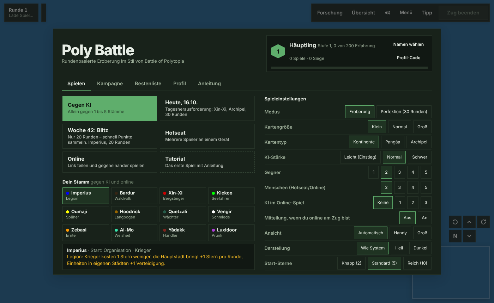

# Poly Battle

[English](README.md) · **Deutsch**

Rundenbasierte Eroberung im Browser, angelehnt an *The Battle of Polytopia*: Gründe Städte, erforsche Technologien und erobere eine Welt aus Sechsecken – in Low-Poly-3D, auf PC, Tablet und Handy.

**[Jetzt spielen](https://hjorven.github.io/Poly-battle-web/)** · [Wiki](https://github.com/hjorven/Poly-battle-web/wiki/Startseite) · [Fehler melden](https://github.com/hjorven/Poly-battle-web/issues/new/choose)


## Was dich erwartet

- **12 Stämme** mit eigener Start-Technologie und Besonderheit, dazu KI-Gegner mit Persönlichkeit (Eroberer, Händler, Seefahrer, Baumeister).
- **27 Einheiten** an Land, auf See und in der Luft – vom Krieger über Waldläufer, Bannerträger, Rammbock und Händlerkarren bis zu Brander und Kriegsluftschiff, mit Veteranen und Aufrüsten.
- **45 Technologien** in einem Wabenbaum mit fünf Stufen.
- **Städte ausbauen** in einer 3D-Ansicht des Stadtgebiets: Feld antippen, Gebäude wählen – jedes zeigt vorher, wie viele Sterne es pro Runde mehr bringt, auch durch Nachbarn wie Windmühle und Farm. Stadtstufen bringen Belohnungen, Monumente werden durch Erfolge freigeschaltet.
- **Gelände mit Wald, Bergen, Hügeln, Sumpf und Eis**, dazu Nebel, Diplomatie, Handel, Brücken, Häfen, Wachtürme, Ruinen, Leuchttürme und **Söldnerlager**, in denen du Einheiten ohne die passende Technologie anwirbst.
- **KI-Lehrling:** Der Knopf „Tipp“ zeigt und erklärt, was die KI an deiner Stelle tun würde.
- **Wiederholung:** Nach Spielende jede Runde ansehen oder die ganze Partie im Zeitraffer ablaufen lassen.
- **Ausbalanciert:** Stämme und Einheiten werden mit KI-Turnieren gemessen (240 Partien: jeder Stamm gewinnt 16–31 %).
- **Spielmodi:** gegen die KI, Hotseat an einem Gerät, online per Link (mit Aufgeben, Zugzeit und einer Liste deiner Partien), Tutorial in fünf Lektionen (Grundlagen, Städte, Forschung und Bauen, Kampf, Erkunden), 13 Kampagnen-Missionen, Tages- und Wochen-Herausforderung mit Bestenliste.
- **Profil** mit Stufen, 20 Erfolgen, freischaltbarem Aussehen und Statistik; mit dem Profil-Code geht es auf jedem Gerät weiter.
- **Freie Karte:** Die Bedienung liegt in schwebenden Kärtchen an den Rändern. Wählst du eine Stadt oder Einheit, steht ein Schild mit ihren Werten direkt daran, die Aktionen liegen als Werkzeugreihe unten – angelehnt an Mini Metro.
- **Bedienung** mit Maus und Tastatur oder Touch; Ziehen und Angreifen brauchen zwei Tipps, damit nichts aus Versehen passiert. Kein Rückgängig – jeder Zug zählt.
- **Hell oder dunkel:** folgt der Systemeinstellung oder ist fest wählbar.




Regeln, Werte und Tabellen stehen im **[Wiki](https://github.com/hjorven/Poly-battle-web/wiki/Startseite)**.

## Lokal starten

Kein Build-Schritt, keine Abhängigkeiten außer Node.js für die Tests und einem statischen Webserver.

```bash
git clone https://github.com/hjorven/Poly-battle-web.git
cd Poly-battle-web
npm run serve        # http://localhost:8080
npm test             # Logiktests
npm run test:browser # das echte Spiel in Chromium (einmalig vorher npm install)
npm run test:db      # Datenbank-Tests (braucht lokales Postgres, siehe scripts/test-db.sh)
```

Three.js und supabase-js liegen unter `vendor/` im Repository, es wird nichts von fremden Servern nachgeladen. Ein Service Worker (`sw.js`) merkt sich die Dateien, so läuft das Spiel nach dem ersten Besuch auch ohne Verbindung. Gegen KI, Hotseat, Kampagne und Herausforderungen laufen ohne Server; Online-Partien und die Bestenliste nutzen Supabase.

## Aufbau

```
index.html              Einstieg, Importmap, Dialoge
sw.js                   Service Worker (offline spielen)
vendor/                 Three.js 0.160.0 und supabase-js 2.45.4
css/style.css           Gestaltung
js/config.js            Spieldaten und Balancing
js/rules.js             Spielregeln (reine Funktionen, getestet)
js/ai.js                KI
js/render.js            3D-Darstellung mit Three.js (auch die 3D-Ansicht im Bau-Fenster)
js/ui.js                Kärtchen, Schild und Werkzeugreihe, Bau-Fenster, Forschung, Menüs
js/main.js              Verkabelung, Eingabe, Zugablauf
js/net.js               Online-Partien, Profile, Bestenliste (Supabase)
js/actionlog.js         Zugprotokoll der Herausforderungen, Nachspielen zur Punkteprüfung
js/save.js              Lokaler Spielstand
js/profile.js           Profil, Erfolge, Herausforderungen
js/campaign.js          Kampagne
supabase/migrations/    Datenbank-Schema und Server-Funktionen
scripts/gen-wiki.mjs    erzeugt die Datenseiten des Wikis (Englisch und Deutsch)
scripts/screenshots.mjs nimmt die Bilder unter docs/ auf
docs/wiki/              Wiki-Seiten (Englisch), docs/wiki/de/ auf Deutsch
test/                   Logik-, Browser- und Datenbank-Tests
```

Mehr dazu auf der Wiki-Seite [Technik](https://github.com/hjorven/Poly-battle-web/wiki/Technik).

Die Doku gibt es auf Englisch (Hauptsprache) und Deutsch. Das Spiel selbst ist auf Deutsch.

## Online und Datenschutz

Clients haben keinen direkten Zugriff auf die Tabellen. Gelesen und geschrieben wird nur über Datenbank-Funktionen, die prüfen, wer mitspielt, wer am Zug ist und ob Namen plausibel sind. Laufende Partien sieht nur, wer mitspielt; nach jedem Zug schickt die Datenbank über Realtime nur eine Klingel, den Stand holt sich der Client geprüft ab. Punkte der Herausforderungen zählen erst, wenn `scripts/verify-scores.mjs` (GitHub Actions, alle 10 Minuten, Secret `SUPABASE_SERVICE_ROLE_KEY`) die Partie aus dem mitgeschickten Zugprotokoll (`js/actionlog.js`) nachgespielt hat. Spieler-Kennungen liegen nur als SHA-256-Prüfsumme in der Datenbank. Gespeichert werden Spielstände, Name, Profildaten und Punkte – keine E-Mail-Adressen, kein Konto. Die Datenschutzerklärung für Spieler steht in [datenschutz.html](datenschutz.html) (im Spielmenü unter dem Titel verlinkt).

## Mitmachen

Fehlerberichte, Ideen und Pull Requests sind willkommen. Wie das abläuft, steht in [CONTRIBUTING.de.md](CONTRIBUTING.de.md).

## Lizenz

[MIT](LICENSE). *The Battle of Polytopia* ist ein Spiel von Midjiwan; Poly Battle ist ein unabhängiges Fanprojekt und steht in keiner Verbindung dazu.
