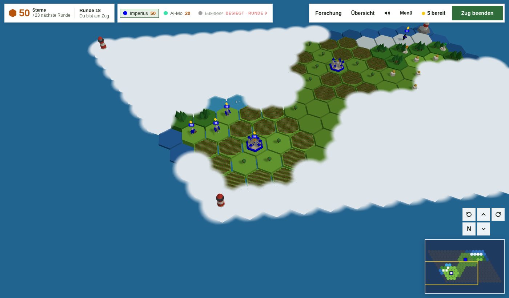
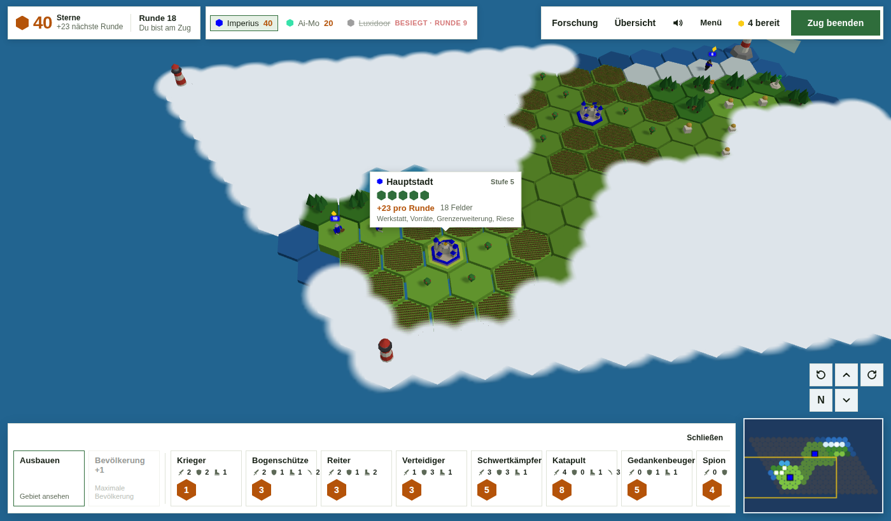
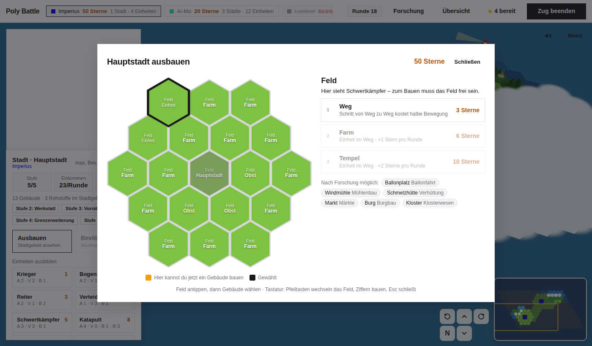

# Poly Battle

**English** · [Deutsch](README.de.md)

Turn-based conquest in the browser, inspired by *The Battle of Polytopia*: found cities, research technologies and conquer a world of hexagons – in low-poly 3D, on PC, tablet and phone.

**[Play now](https://hjorven.github.io/Poly-battle-web/)** · [Wiki](https://github.com/hjorven/Poly-battle-web/wiki) · [Report a bug](https://github.com/hjorven/Poly-battle-web/issues/new/choose)

> The game itself is in German. The documentation is available in English and German.



## What to expect

- **12 tribes**, each with its own starting technology and special trait, plus AI opponents with a personality (conqueror, merchant, seafarer, builder).
- **27 units** on land, at sea and in the air – from warrior via ranger, banner bearer, battering ram and trader cart to fire ship and war airship, with veterans and upgrades.
- **55 technologies** in a honeycomb tree with six tiers.
- **Develop your cities** in a 3D view of the city area: tap a tile, pick a building – each shows in advance how many extra stars per turn it brings, including from neighbours such as windmill and farm. City levels bring rewards, and monuments are unlocked by achievements.
- **Terrain with forests, mountains, hills, swamps and ice**, plus fog of war, diplomacy, trade, bridges, ports, watchtowers, ruins, lighthouses and **mercenary camps** where you hire units without the matching technology.
- **AI apprentice:** the “Tipp” (Hint) button shows and explains what the AI would do in your place.
- **Replay:** after the game, watch every turn or run the whole match as a time-lapse.
- **Balanced:** tribes and units are measured in AI tournaments (240 games: every tribe wins 16–31 %).
- **Game modes:** against the AI, hotseat on one device, online via link (with resigning, turn timer and a list of your matches), tutorial, 13 campaign missions, daily and weekly challenge with leaderboard.
- **Profile** with levels, 20 achievements, unlockable cosmetics and statistics; with the profile code you can continue on any device.
- **Open map:** the controls sit in floating cards along the edges. Select a city or unit and a sign with its stats appears right next to it, with the actions in a toolbar at the bottom – inspired by Mini Metro.
- **Controls** with mouse and keyboard or touch; moving and attacking take two taps so nothing happens by accident. No undo – every move counts.
- **Light or dark:** follows the system setting or can be set manually.





Rules, stats and tables are in the **[Wiki](https://github.com/hjorven/Poly-battle-web/wiki)** ([auf Deutsch](https://github.com/hjorven/Poly-battle-web/wiki/Startseite)).

## Running locally

No build step and no dependencies apart from Node.js for the tests and a static web server.

```bash
git clone https://github.com/hjorven/Poly-battle-web.git
cd Poly-battle-web
npm run serve        # http://localhost:8080
npm test             # logic tests
npm run test:browser # the real game in Chromium (run npm install once first)
npm run test:db      # database tests (needs a local Postgres, see scripts/test-db.sh)
```

Three.js and supabase-js live under `vendor/` in the repository; nothing is loaded from third-party servers. A service worker (`sw.js`) caches the files, so the game also works offline after the first visit. Games against the AI, hotseat, campaign and challenges run without a server; online matches and the leaderboard use Supabase.

## Structure

```
index.html              entry point, import map, dialogs
sw.js                   service worker (play offline)
vendor/                 Three.js 0.160.0 and supabase-js 2.45.4
css/style.css           styling
js/config.js            game data and balancing
js/rules.js             game rules (pure functions, tested)
js/ai.js                AI
js/render.js            3D rendering with Three.js (including the 3D view in the build window)
js/ui.js                cards, sign and toolbar, build window, research, menus
js/main.js              wiring, input, turn flow
js/net.js               online matches, profiles, leaderboard (Supabase)
js/actionlog.js         move log of the challenges, replayed to verify scores
js/save.js              local save game
js/profile.js           profile, achievements, challenges
js/campaign.js          campaign
supabase/migrations/    database schema and server functions
scripts/gen-wiki.mjs    generates the wiki data pages (English and German)
scripts/screenshots.mjs takes the images under docs/
docs/wiki/              wiki pages (English), German in docs/wiki/de/
test/                   logic, browser and database tests
```

More on the wiki page [Technical Overview](https://github.com/hjorven/Poly-battle-web/wiki/Technical-Overview).

## Online and privacy

Clients have no direct access to the tables. Reading and writing only happens through database functions that check who is playing, whose turn it is and whether names are plausible. Running matches are only visible to their players; after each move the database only sends a ping via Realtime, and the client then fetches the state through a checked function. Challenge scores only count once `scripts/verify-scores.mjs` (GitHub Actions, every 10 minutes, secret `SUPABASE_SERVICE_ROLE_KEY`) has replayed the game from the submitted move log (`js/actionlog.js`). Player IDs are stored in the database only as SHA-256 checksums. Stored are game states, name, profile data and scores – no email addresses, no account. The privacy policy for players is [datenschutz.html](datenschutz.html) (German, linked in the game menu under the title).

## Contributing

Bug reports, ideas and pull requests are welcome. [CONTRIBUTING.md](CONTRIBUTING.md) explains how it works.

## License

[MIT](LICENSE). *The Battle of Polytopia* is a game by Midjiwan; Poly Battle is an independent fan project and is not affiliated with it.
